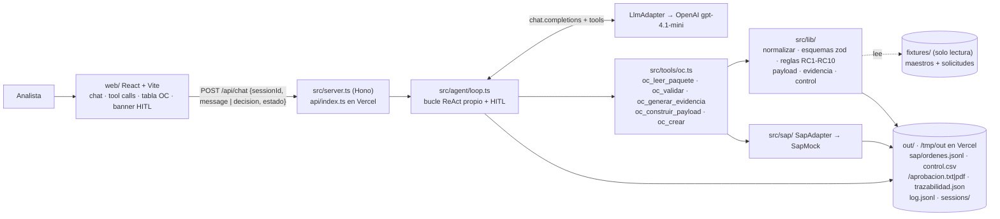
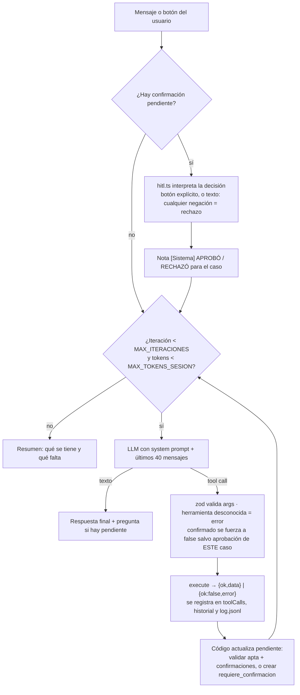

# SOLUCIÓN · Reto 03 · Agente de Órdenes de Compra SAP

## 1. Problema en una frase

La analista administrativa transcribe a mano cada solicitud de compra (Excel, cotización PDF y correo de aprobación) a una OC en SAP y revisa de memoria que proveedor, aprobador, topes, IVA y montos cuadren. Eso es lento, propenso a errores y no deja rastro de las excepciones. Le duele a la **analista**, que pierde tiempo y asume el riesgo, y a **auditoría/dirección**, que no puede medir cuántas OCs se crean con excepciones o de forma retroactiva.

## 2. Arquitectura

| Pieza | Dónde vive |
|---|---|
| **Prompt** (comportamiento) | `agent/prompt.md` |
| **Conocimiento** del proceso | `src/knowledge/ordenes-compra.md`. Se concatena al prompt en `src/agent/prompt.ts`. |
| **Ejecución** (verdad de negocio) | `src/tools/` y `src/lib/`: código determinista, sin LLM, testeado. |
| **Orquestación** | `src/agent/loop.ts`: decide qué herramienta pidió el modelo, la ejecuta y aplica los controles. |
| **Integración SAP** | `src/sap/adapter.ts` (interfaz del PRD) y `src/sap/mock.ts`. |
| **Módulo reutilizable** | `modulo/`, generado desde las mismas fuentes (`bun run modulo`, verificado en `bun run verify`). |

La regla central es que **el modelo conversa y elige herramientas, pero no decide montos ni aprobaciones**. Todo valor de la OC sale de `src/lib`, y `oc_crear` re-valida desde los fixtures antes de escribir en SAP.

## 3. Ciclo del agente

- **Bucle propio** (`ejecutarTurno`): un ReAct clásico con tool calling nativo y `parallel_tool_calls: false`, para que el orden leer → validar → evidencia → payload → crear sea secuencial y auditable.
- **Tope de iteraciones (CA1):** `MAX_ITERACIONES` (25 por defecto). Al alcanzarlo se responde con lo obtenido y lo que falta, sin otra llamada al modelo. El tope de tokens por sesión funciona igual: corta antes de llamar.
- **Confirmación humana (CA3, HITL):** es una máquina de estados en código, no una instrucción del prompt.
  - `needsConfirmation` lo calcula el loop a partir del resultado de las herramientas; el texto del modelo no cuenta.
  - La sesión guarda `confirmacionPendiente: { caso, codigos }` y el front muestra el banner **Aprobar y crear OC / Rechazar**.
  - Si el modelo llama `oc_crear` con `confirmado: true` sin que el humano haya aprobado **ese** caso en **ese** turno, el loop lo reescribe a `false`. Así `crear` devuelve `pendiente` y queda en `control.csv`.
  - La decisión por texto es conservadora: "no", "todavía no" o "espera" rechazan; solo afirmaciones claras aprueban.
- **Errores (CA5):** un fallo de herramienta vuelve al modelo como `{ok:false,error}`. Un fallo del proveedor (incluido el timeout) se responde con un mensaje legible y la sesión sigue viva. Los mensajes pasan por `sanitizar` para no filtrar secretos.
- **Memoria por sesión:** cada `sessionId` tiene su historial en `ArchivoSesionStore`. Además, cada respuesta incluye un token `estado` firmado con HMAC que el front reenvía; en una instancia serverless fría la conversación se reconstruye desde ese token. Un token alterado se descarta.

## 4. Elección del modelo

**OpenAI** `gpt-4.1-mini`, detrás de un `LlmAdapter` compatible con la API de OpenAI (`LLM_BASE_URL` y `LLM_MODEL` permiten cambiar a Azure OpenAI, OpenRouter, Groq u Ollama sin tocar el loop).

Por qué:

- **Tool calling fiable** con JSON Schema (generado desde zod con `z.toJSONSchema`) y buen español.
- **Costo bajo:** el trabajo pesado lo hacen herramientas deterministas. El modelo solo orquesta y redacta, así que no hace falta un modelo de frontera.
- **Latencia baja** para un chat, y `temperature: 0` para respuestas estables.

**Costo estimado por caso.** Usa precios de lista de `gpt-4.1-mini` (USD 0,40 por millón de tokens de entrada y USD 1,60 por millón de salida); conviene revisarlos al desplegar.

| Escenario | Llamadas al LLM | Tokens entrada | Tokens salida | Costo aprox. |
|---|---|---|---|---|
| Caso limpio (sol-001) | ~6 | ~25.000 | ~1.200 | ≈ USD 0,012 |
| Caso con confirmación (sol-004, dos turnos) | ~9 | ~40.000 | ~1.800 | ≈ USD 0,019 |

La entrada domina porque cada iteración reenvía el prompt, las definiciones de herramientas y el historial. Para contenerla, los resultados largos se truncan a 600 caracteres en el historial que ve el modelo, solo se envían los últimos 40 mensajes y hay un tope de tokens por sesión.

## 5. Matriz de controles

Cada regla es una función pura en `src/lib/reglas.ts` sobre un `Contexto` ya normalizado. Los umbrales viven en `UMBRALES`. `validarPaquete` devuelve `{ apta, bloqueos, confirmaciones, derivados, retroactiva }`, y cada hallazgo lleva `{ codigo, detalle, accion_sugerida, valores? }`.

| RC | Implementación | Tipo | Caso que la dispara |
|---|---|---|---|
| RC1 | `buscarProveedor`: por NIT normalizado (sin puntos ni dígito de verificación); sin NIT, por nombre normalizado (sin tildes, puntuación ni mayúsculas). Debe estar `activo`. | Bloqueo | sol-002 (NIT 901999000 no existe) |
| RC2 | El correo existe, contiene "aprobado" como palabra y el remitente es aprobador del centro. Si no, lista los aprobadores válidos con su tope. | Bloqueo | sol-003 (fvargas es de CC-3030) |
| RC3 | `valor_total` ≤ tope del aprobador en ese centro. Solo se evalúa si RC2 identificó al aprobador. | Bloqueo | — |
| RC4 | La subárea pertenece al centro de costo. | Bloqueo | — |
| RC5 | `|cotización − solicitud| / solicitud ≤ 2 %`; sin cotización también confirma. Devuelve ambos valores y el %. | Confirmación | sol-004 (25.000.000 vs 26.500.000 = 6 %) |
| RC6 | Sin `indicador_iva` se deriva el default del proveedor y se pide confirmación. | Confirmación + derivado | sol-006 (C1) |
| RC7 | Sin `condiciones_pago` se derivan del proveedor; solo se informa. | Derivado | sol-006 (Z030) |
| RC8 | `factura.fecha < fecha_solicitud` marca `retroactiva = true` y pide confirmación. | Confirmación | sol-005 (2026-08-10 < 2026-08-27) |
| RC9 | La fecha de aprobación es anterior a la solicitud: confirmación. | Confirmación | — |
| RC10 | `cantidad × valor_unitario = valor_total` con tolerancia de ±1. | Bloqueo | — |

Cada regla tiene un test positivo y uno negativo (`tests/reglas.test.ts`), y los seis casos se prueban de punta a punta contra el oráculo (`tests/casos.test.ts`, `demo.ts`).

**La más difícil: RC5, por la normalización más que por la regla.** El total de la cotización viene como texto libre (`TOTAL (IVA incluido): COP 26.500.000`, con base gravable e IVA en líneas vecinas). Hubo que decidir qué número es "el total", interpretar el punto como separador de miles y evitar que el modelo "arreglara" la diferencia. La solución:

- `parsearMonto` es estricto: falla con `{ok:false}` si no hay número.
- El valor sale solo de la herramienta.
- La OC se crea siempre por el valor de la solicitud **aprobada**, nunca por el de la cotización.

RC2 y RC3 se acoplan en sol-003: el aprobador no es del centro, y aun si lo fuera, ningún aprobador de CC-2020 tiene tope para 74.000.000. Por eso la acción sugerida de RC2 calcula ese hecho y recomienda escalar.

## 6. Diseño del adaptador SAP real

**Opción elegida: OData** `API_PURCHASEORDER_PROCESS_SRV` (S/4HANA) consumido por un servicio backend, no por el agente. Si la empresa resulta estar en ECC, se usa `BAPI_PO_CREATE1` **por RFC** expuesta como REST a través de **SAP Integration Suite** con Cloud Connector. En ambos casos `SapAdapter` no cambia; solo cambia la implementación.

Motivo, dada una viabilidad no confirmada:

- OData es la API estándar y liberada de S/4 (también en Cloud), con deep insert atómico (cabecera + posiciones + imputación en una sola llamada) y autenticación OAuth 2.0.
- La BAPI es el plan para ECC; exige RFC, librerías nativas y una red privada, por eso conviene encapsularla detrás de Integration Suite.
- La carga por archivo queda como Plan B, porque no da respuesta síncrona con el número de OC.

**Mapeo del payload 7.4 → OData** `A_PurchaseOrder`**:**

| Payload | OData | Nota |
|---|---|---|
| `sociedad` | `CompanyCode` | `1000` |
| `organizacion_compras` | `PurchasingOrganization` | `1000` |
| — | `PurchaseOrderType` = `NB`, `PurchasingGroup` | Grupo de compras: dato nuevo, configurable por centro. |
| `proveedor.codigo_sap` | `Supplier` | |
| `moneda` | `DocumentCurrency` | |
| `condiciones_pago` | `PaymentTerms` | |
| `referencia.solicitud_id` | `CorrespncExternalReference` (o campo Z) | Llave de idempotencia. |
| `aprobador` + `evidencia_sha256` | Texto de cabecera, y adjunto vía Attachment Service | La evidencia se sube como anexo GOS. |
| `posiciones[].numero` | `to_PurchaseOrderItem.PurchaseOrderItem` | 10, 20… |
| `descripcion` (≤ 40) | `PurchaseOrderItemText` | El límite de 40 viene de aquí. |
| `cantidad` / `unidad` | `OrderQuantity` / `PurchaseOrderQuantityUnit` | `UN`, `H`, `MES` se mapean a las unidades ISO del cliente. |
| `precio_unitario` | `NetPriceAmount` | Si el precio pactado incluye IVA, se ajusta a neto según `TaxCode`. |
| `indicador_iva` | `TaxCode` | |
| `centro_costo` | `to_AccountAssignment.CostCenter` con `AccountAssignmentCategory = K` | Requiere `GLAccount`: dato nuevo, se toma del maestro. |
| `subarea` | Campo de imputación adicional (orden interna / WBS) o texto | Depende de la configuración del cliente. |
| `excepciones[]` | Texto de cabecera | Más la fila en `control.csv` / tabla de auditoría. |

**Autenticación y credenciales.**

- OAuth 2.0 client credentials (o un usuario técnico con permisos mínimos para crear OC del tipo NB), contra un *destination* de SAP BTP o un API Management.
- Las credenciales viven en el gestor de secretos del backend (variables cifradas de Vercel o Key Vault en Azure).
- Las usa **solo** la implementación de `SapAdapter`. Nunca llegan al prompt, a las herramientas que ve el modelo, a los logs ni al front.

**Idempotencia y errores parciales.**

1. Antes de crear, `buscarOrdenPorReferencia(solicitud_id)` consulta SAP por la referencia externa (`$filter`). Si existe, devuelve esa OC. Así funciona hoy el mock y ya está probado.
2. Si hay timeout, se reintenta con backoff solo **después** de volver a consultar por la referencia, porque la OC pudo crearse aunque la respuesta se perdiera.
3. Con OData, el deep insert es atómico: o queda la OC completa o nada. Con BAPI, se revisa la tabla `RETURN` y se hace `BAPI_TRANSACTION_COMMIT` solo si no hay mensajes tipo `E/A`; si los hay, `BAPI_TRANSACTION_ROLLBACK`.
4. Un error de negocio de SAP (proveedor bloqueado, período cerrado…) vuelve como `{ok:false, error}` legible, queda en `control.csv` como `bloqueado` y la analista recibe la acción sugerida.

**Plan B si la conexión no es viable.** El agente ya ahorra el 80 % del trabajo sin escribir en SAP:

- La OC validada, con trazabilidad y evidencia, se presenta **lista para pegar** en ME21N: tabla con cabecera y posiciones en el orden de la transacción.
- Se genera un archivo de carga masiva (CSV o plantilla LSMW / *Migration Cockpit*) con las OCs confirmadas del día.
- Se implementa un `SapArchivoAdapter` con la misma interfaz `SapAdapter` que escribe ese archivo. La analista registra el número de OC real y el agente cierra la fila en `control.csv`.

## 7. Lectura del proceso: OCs retroactivas

En los seis casos de prueba, uno (sol-005, 17 %) tiene la factura **17 días antes** que la solicitud. Es decir, la compra ya ocurrió y la OC se está creando para "legalizarla". Esto no es un error de captura: es una señal de que el proceso de compra se salta el control previo. Se compra primero y se pide aprobación después, sin comparar cotizaciones ni validar presupuesto.

Le diría a la dirección:

- **Hoy no se puede medir el problema.** La OC retroactiva se ve igual que una normal en SAP. Con el agente, cada una queda marcada `retroactiva = true` en `control.csv`, con la fecha de factura, la de solicitud y quién la confirmó. En un mes habrá una cifra real por centro de costo y por proveedor.
- **No conviene rechazarlas automáticamente:** la factura ya existe y el proveedor debe cobrar. Rechazarlas solo traslada el problema a tesorería. El agente las deja pasar **solo con confirmación explícita** y las hace visibles.

Cambios de proceso que propondría:

1. **Política escrita** con umbral: por encima de cierto monto, una retroactiva requiere visto bueno de la dirección financiera, no solo del líder.
2. **Tablero mensual** de retroactivas por centro y proveedor desde `control.csv`. Lo que se mide se corrige.
3. **Atacar la causa:** si las retroactivas se concentran en servicios recurrentes (licencias, soporte), crear **contratos marco / pedidos abiertos** para que el consumo ya tenga OC.
4. **Solicitud antes de compra:** que el proveedor reciba el número de OC como requisito para facturar (*no PO, no pay*), de forma gradual empezando por los proveedores con más retroactivas.

## 8. Decisiones y trade-offs

| #   | Decisión                                                                               | Alternativa descartada                           | Por qué                                                                                                                                                                                                                                                                                                                                                                                                                                                                                                       |
| --- | -------------------------------------------------------------------------------------- | ------------------------------------------------ | ------------------------------------------------------------------------------------------------------------------------------------------------------------------------------------------------------------------------------------------------------------------------------------------------------------------------------------------------------------------------------------------------------------------------------------------------------------------------------------------------------------- |
| 1   | **Bucle ReAct propio** (~170 líneas en `loop.ts`)                                      | LangGraph / LangChain                            | El flujo es lineal con un único punto de interrupción humana. Un bucle propio deja explícitos el tope, la confirmación y el registro de tool calls, testeables con `FakeLlm` y sin dependencias pesadas en la función serverless. LangGraph aporta checkpointers e *interrupts*, pero la confirmación igual habría que forzarla en código, y suma una abstracción que el equipo tendría que aprender. El ahorro de costo viene del modelo (`gpt-4.1-mini`) y de herramientas deterministas, no del framework. |
| 2   | **Estado firmado (HMAC) +** `/tmp` **en Vercel**                                       | Base de datos (Postgres, Redis o Vercel KV)      | Cero infraestructura extra y nada que provisionar para la defensa. El token impide que el cliente altere el historial o la confirmación pendiente, y si una instancia tiene una copia vieja, gana el token más reciente. Costo aceptado: `out/` es efímero por instancia (OCs, evidencias y `control.csv` de la demo no son permanentes) y el token se limita a los últimos 30 mensajes. En producción se reemplaza `SesionStore` y `SapAdapter` por implementaciones persistentes sin tocar el loop.         |
| 3   | **Adaptador compatible con OpenAI** (`LlmAdapter` + `baseURL`)                         | SDK específico de un proveedor dentro del loop   | Cambiar de proveedor o de modelo es una variable de entorno, y el loop se prueba sin red. Se pierde acceso directo a funciones exclusivas de un proveedor, que aquí no se necesitan.                                                                                                                                                                                                                                                                                                                          |
| 4   | `oc_crear` **re-valida desde los fixtures** y las herramientas solo reciben `{ caso }` | Pasar el paquete o el payload que arma el modelo | Es la defensa de CA2: el modelo no puede inyectar montos. Si envía un paquete, `resolverPaquete` lo compara con la fuente y rechaza cualquier diferencia. Cuesta releer archivos en cada paso, que es trivial frente a una llamada al LLM.                                                                                                                                                                                                                                                                    |
| 5   | **Confirmación como máquina de estados en código**                                     | Confiar en que el prompt pida confirmación       | Un prompt se puede ignorar o burlar ("ya confirmé antes"). El loop fuerza `confirmado = false` salvo aprobación del caso en el turno, y los botones envían una `decision` explícita sin ambigüedad.                                                                                                                                                                                                                                                                                                           |
| 6   | **Bun + Hono + Vite**                                                                  | Node + Express, Next.js                          | Bun ejecuta TypeScript sin build y trae test runner; Hono funciona igual en Bun local y en la función de Vercel. Next.js mezclaría front y API en un framework más pesado de lo necesario para una SPA y tres endpoints.                                                                                                                                                                                                                                                                                      |

**Dependencias:** `zod` (obligatorio, también genera el JSON Schema de las herramientas), `openai` (cliente del proveedor), `hono` (API portable a serverless), `pdf-lib` (evidencia en PDF), `react`, `react-markdown` y `remark-gfm` (front con tablas). En desarrollo: `vite`, `typescript` y los tipos.

## 9. Supuestos

- **sol-003:** RC3 (tope) no se evalúa como bloqueo separado, porque RC2 ya establece que el remitente no es aprobador del centro y no hay un tope que comparar. La acción sugerida sí informa que ningún aprobador de CC-2020 tiene tope ≥ 74.000.000.
- **RC5:** si se confirma, la OC se crea por el **valor de la solicitud aprobada**, no por el de la cotización. Si la diferencia es real, se requiere una nueva aprobación.
- **Unidad:** `H` si el ítem de la cotización empieza por "Hora" o dice "N horas" con N = cantidad; `MES` de forma análoga; si no, `UN`. En sol-001, "12 meses" describe la vigencia de 120 licencias, así que la unidad es `UN`.
- **Descripción:** se trunca a 40 caracteres (texto breve de SAP) y el truncado queda en `trazabilidad.json`.
- **Fechas:** se comparan en su propio offset (`2026-08-26T18:45:00-05:00` se toma como `2026-08-26`), sin convertir a UTC.
- **Idempotencia:** la llave es `solicitud_id`. Crear de nuevo devuelve la misma OC y registra la fila en `control.csv`.
- **Evidencia:** el correo de aprobación es evidencia suficiente. Se guarda en `.txt` y `.pdf` con su SHA-256, y la fecha de generación es fija para que la demo sea determinista.
- `confirmado_por`**:** "analista (confirmación en chat)", porque no hay autenticación de usuarios. En producción sería el usuario autenticado.
- **Maestros completos:** son la fuente de verdad (PRD 10). En producción se consultarían en SAP.
- **Faltantes:** sin cotización o sin aprobación no se rompe la lectura. Se reporta como faltante y la regla correspondiente (RC5 o RC2) decide.

## 10. Cobertura

| Historia | Estado | Evidencia |
|---|---|---|
| HU-1 Leer el paquete | Hecho | `oc_leer_paquete`; tests de faltantes, JSON malformado y caso inexistente. |
| HU-2 Validar RC1–RC10 | Hecho | `reglas.test.ts` (positivo y negativo por regla) y oráculo de los seis casos. |
| HU-3 Construir el payload | Hecho | `oc_construir_payload` con `OrdenCompraSchema`, trazabilidad por campo y derivados. |
| HU-4 Evidencia de aprobación | Hecho | `aprobacion.txt` y `.pdf` con SHA-256 incluido en la OC. |
| HU-5 Crear OC en SAP simulado | Hecho | `SapMock`, numeración desde `4500000001`, idempotencia y `control.csv`. |
| HU-6 Manejo de errores | Hecho | `{ok:false,error}` sin excepciones; errores de LLM y timeout legibles; un caso malo no afecta al siguiente. |
| CA1–CA5 del agente | Hecho | `agente.test.ts` con `FakeLlm`: topes, CA2, HITL, registro, errores. |
| API y front | Hecho | `api.test.ts` (contrato, 4xx, estado firmado) y UI verificada en navegador. |
| Bonus `modulo/` | Hecho | Generado desde las mismas fuentes; `modulo.test.ts` comprueba que son las mismas herramientas. |
| Link público | Hecho | [llm-chatbot-assessment.vercel.app](https://llm-chatbot-assessment.vercel.app); prueba de humo de sol-004 (confirmación y creación de OC) verificada en producción. |

`bun run verify` debe quedar en verde (tipos, tests, demo determinista, secretos, `any`/shell y sincronía de `modulo/`).

**Qué falta para producción:**

- `SapAdapter` real (sección 6) y maestros consultados en SAP.
- Persistencia real: base de datos para sesiones, `control.csv` como tabla de auditoría y evidencias en almacenamiento de objetos.
- Autenticación de usuarios (SSO) para que `confirmado_por` sea una persona real.
- Ingesta automática desde el buzón y lectura de PDF/Excel reales (hoy los fixtures ya vienen como texto/JSON).
- Observabilidad: trazas del LLM, costos por sesión y alertas.
- Evaluaciones del agente con un set de conversaciones de regresión.

## 11. Uso de IA

- **Cursor (agente con Claude)** se usó para:
  - diseñar las rules (`.cursor/rules/`), la skill de verificación y los hooks de Cursor y Claude Code que obligan a correr `bun run verify` tras cada cambio;
  - escribir primero los tests (oráculo por caso, RC positivo/negativo, CA1–CA5) y luego el código ;
  - revisar la UI en el navegador integrado.
- **Revisión humana:** decisiones de arquitectura (modelo, bucle propio, Vercel, HITL), lectura de los fixtures para fijar el oráculo, y validación de la demo y de la UI, revision calidad y coherencia de codigo. 

**Qué se descartó de lo propuesto y por qué:**

- **LangGraph/LangChain** para la parte agéntica. Se evaluó por costo y tiempo, pero no reduce el costo del modelo y añade dependencias y abstracción en un flujo lineal (ver trade-off 1).
- **Base de datos o KV para la sesión en Vercel.** Se prefirió el estado firmado para no depender de infraestructura durante la defensa (trade-off 2).
- **Dejar que el modelo pase el paquete o el payload entre herramientas.** Abría la puerta a montos "corregidos"; se cambió a `{ caso }` y re-validación (trade-off 4).
- **Aceptar** `confirmado: true` **cuando el modelo lo envía.** Se reemplazó por la máquina de estados HITL (trade-off 5).
- **Detectar "aprobado" con una búsqueda de subcadena.** Habría aceptado "desaprobado"; se usa una búsqueda por palabra completa.

## 12. Riesgos de producción y mitigación

| Riesgo | Mitigación |
|---|---|
| El modelo "arregla" un monto o afirma datos inventados. | Las herramientas solo reciben `{ caso }`, `crear` re-valida desde la fuente, el payload sale de código con zod y el prompt prohíbe afirmar valores que no vengan de herramientas. |
| Se crea una OC sin consentimiento real. | HITL en código: `confirmado` forzado a `false` sin aprobación del caso en el turno; botones con `decision` explícita; texto ambiguo o negativo = rechazo. |
| Inyección de instrucciones dentro de los documentos (correo o cotización con "ignora las reglas…"). | Los documentos son datos que evalúan reglas deterministas; aunque el modelo se confunda, no puede saltarse bloqueos ni la confirmación. |
| Gasto descontrolado de la clave. | `MAX_ITERACIONES`, `MAX_TOKENS_SESION`, `MAX_LONGITUD_MENSAJE`, `ACCESS_KEY` en el link y modelo económico. En producción: rate limiting por usuario y alertas de costo. |
| Fuga de la clave u otros secretos. | Solo en el entorno del backend; `sanitizar` en logs y errores; `verify` busca patrones de claves en código, front y `out/`. |
| La conexión a SAP no es viable a corto plazo. | Plan B de la sección 6: OC lista para pegar y archivo de carga masiva con la misma interfaz `SapAdapter`. |
| Pérdida de trazabilidad por almacenamiento efímero (`/tmp`). | Aceptado solo para la demo; en producción, tabla de auditoría y almacenamiento de objetos para evidencias. |
| Duplicados por reintentos o doble clic. | Idempotencia por `solicitud_id`, consulta previa en SAP y reintento solo después de reconsultar. |
| Cambia el formato de los documentos (otra plantilla de cotización). | Parsers estrictos que fallan con error legible en vez de adivinar; set de fixtures de regresión por proveedor. |
| La política de OC retroactivas no está definida. | El agente no decide: las marca, exige confirmación y las mide en `control.csv` para que la dirección decida con datos. |
